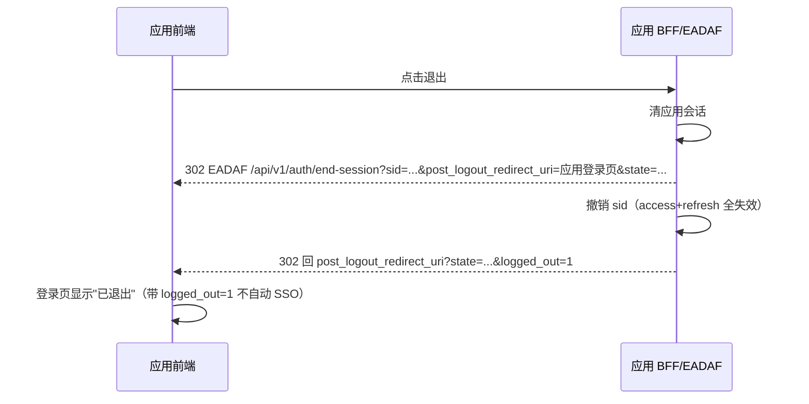

# EADAF 用户 SSO：会话、令牌与登出 方案计划

> 状态：**待评审**（本文只做方案与计划，不含代码改动）
> 关联：Issue [#36](https://github.com/adisonshadow/UAC2/issues/36)、PR [#37](https://github.com/adisonshadow/UAC2/pull/37)
> 权威文档：[sso-integration-guide.md](./sso-integration-guide.md)（实施后需同步更新）

---

## 0. 结论摘要

现在的 EADAF SSO **会签发令牌，但没有"会话"这个概念**。由此派生出三类问题，用户报的两个现象只是其中两个切面：

| # | 问题 | 现象 |
|---|------|------|
| A | 验签密钥靠**请求上的 `?app=`** 决定，令牌自己不说明身份 | 任何漏带 `?app=` 的调用 401；客户端把 401 当掉登录 → 掉登录（Issue #36） |
| B | 只有令牌、没有 **IdP 会话**，也没有单点登出 | 应用里"退出"只是清本地，EADAF 会话还在 → 再点登录又被静默登回去（**现象 1**） |
| C | 访问令牌 **24h 不可撤销**、刷新令牌只撤单条、应用侧 401 语义模糊 | EADAF 退出后应用既不真退出、也不回登录页，只弹一句"无效的令牌"（**现象 2**） |

目标是把 EADAF 从"发令牌的服务"升级为**带会话生命周期的最小 OP（OpenID Provider）**，应用侧收敛为一个统一的会话客户端。**Phase 0/1 不需要改表结构、不需要改应用协议**，可以先落地止血；Phase 2/3 才是标准 OIDC 化。

---

## 1. 现象还原（真机证据）

### 现象 1：应用内"退出"后，一登录又被自动登回去

链路（代码级）：

1. 应用退出按钮只做本地清理 → `app_example/src/layout/AppShell.tsx:55`（`clearAuth()` + 跳应用自己的 `/auth/login`）；
2. 用户点"前往登录" → 打开 EADAF `/auth/login?app=YS`；
3. EADAF 控制台发现**自己的平台会话还活着**（`isLoggedIn`）→ 自动执行 SSO 跳转（`frontend/src/pages/Auth/index.tsx:401-437`，注释就是"您已登录，正在打开 XX 应用"）→ 用户又被登回来。

结论：**这是"没有单点登出"的必然结果，不是随机 bug**。应用的 `clearAuth()` 不会、也无从通知 EADAF。

### 现象 2：EADAF 退出后，应用只提示"无效的令牌"，不回登录页

后端日志（2026-10-16 22:41–22:42，应用 app_example）：

```
22:41:02  POST /api/v1/auth/logout                                  认证成功     ← 控制台退出（只撤了平台的那条 refresh）
22:41:02  GET  /api/v1/auth/check                    认证失败：未提供 Authorization 头
22:41:07  GET  /api/v1/auth/check?app=YS             认证成功                 ← 应用的会话仍然完全有效
22:41:07  GET  /api/v1/data/YS/order/Order?app=YS    认证成功
22:41:07  GET  /api/v1/ai/models                     令牌验证失败 invalid signature  ← 应用 AI 助手 401
22:41:07  GET  /api/v1/ai/capabilities?...           令牌验证失败 invalid signature
```

两件事同时成立：

- **控制台退出没有影响应用**：`authController.logout` 只把**被提交的那一条 refresh token** 置为 REVOKED（`backend/src/controllers/authController.js:520-535`），访问令牌 24h 内照旧有效，EADAF 也没有"会话"可以撤；
- **应用某些接口仍然 401**：应用持有的用户 JWT 是**应用密钥**签的，`/v1/ai/*` 这类请求没带 `?app=`，中间件就用平台密钥验签 → `invalid signature` → 401「无效的令牌」。而应用的 401 处置逻辑（本轮刚改过）会先复核 `/auth/check?app=`，复核结果是 200（会话有效）→ **不跳登录页**，于是用户看到的就是"只提示无效的令牌"。

也就是说：现象 2 = A（验签依赖 `?app=` 的历史包袱）+ C（退出不真、401 语义模糊）叠加后的表现。

---

## 2. 现状盘点

| 环节 | 现状 | 问题 |
|------|------|------|
| 登录 | `POST /api/v1/auth/login`（账号密码 + 可配滑块；可选 `application_id`）。带 `application_id` 时用**应用统一密钥**签发用户 JWT | 用户令牌的签发密钥属于"应用"，同一用户在不同应用下是不同密钥签的不同令牌 |
| 令牌 | 平台令牌 / 应用令牌（`type=application`，平台密钥）/ SSO 用户 JWT（应用密钥）。access 24h、refresh 7d（`backend/src/config/index.js:97,197`） | 访问令牌不可撤销；三套令牌语义靠 URL 参数区分 |
| 验签 | `middlewares/auth.js` 按候选密钥依次尝试验签（本轮改造后支持"令牌自述 application_id"） | 仍是**共享密钥 + 请求上下文**模型：没有 `iss`/`aud`/`sid`；应用侧必须拿同一把密钥本地验签 |
| 回调 | `frontend/src/pages/Auth/index.tsx:111` `submitSsoCallback`：HEADER_REDIRECT 把 `access_token`/`refresh_token` 放 **URL query**；POST_REDIRECT 放表单 body。`verify` 是 `bcrypt(timestamp+secret)`，`expires_in` 写死 3600 | 刷新令牌进浏览器地址栏/历史/Referer；无授权码、无 PKCE、`state` 仅透传不校验（无 CSRF 防护）；`expires_in` 与实际 24h 不一致 |
| 刷新 | `POST /api/v1/auth/refresh` 挂在 `auth` 之后（`backend/src/routes/authRoutes.js:392`） | **访问令牌过期后就无法刷新**（刷新需要未过期的访问令牌），只能强制重新登录；刷新无轮换、无重放检测 |
| 登出 | `authController.logout` 只撤一条 refresh；控制台 `AvatarDropdown.tsx:28`、`account/center/index.tsx:79` 只清 `token`/`refresh_token` | 无 IdP 会话、无单点登出；控制台退出**不清理 `sso_token:<app>`**；应用退出根本不通知 EADAF |
| 401 语义 | 应用：任何 401 → 复核 → 会话有效则只报错（本轮改），会话失效则清并跳登录。控制台：`requestInterceptors.ts:105-113` 的 401 分支在 axios 下**不可达**（401 走 errorHandler），实际只弹 toast、不跳登录 | 会话级 / 接口级 401 没有区分标准，"掉登录"和"卡住不跳"两种极端都会出现 |
| 会话记录 | 只有 `uac.refresh_tokens`（user_id / token / expires_at / status），无 `sid`、无设备信息、无"这套会话属于哪个应用" | 无法列出/撤销"某次登录"，无法做"退出所有设备" |
| 基础设施 | Redis 已有封装（`utils/redisClient.js`，依赖不可用时自动降级） | 可用来做撤销集，无需改表 |

---

## 3. 目标与非目标

**目标**

1. **登出是真的**：任一侧登出，该会话的所有令牌立即失效；从 IdP 登出后可选择级联到应用。
2. **令牌自洽**：令牌自己说明身份（`iss`/`aud`/`sub`/`sid`），验签不再依赖 URL 参数，客户端不会因为"忘带参数"被拒。
3. **令牌不落浏览器**：刷新令牌只存在应用 BFF；前端用 httpOnly cookie 或短时内存令牌。
4. **401 语义分层**：会话失效 → 跳登录；接口无权/参数问题 → 报错并给"重新登录"入口，绝不静默卡死。
5. **可运维**：能查看/撤销活跃会话，有审计（登录、刷新、登出、撤销）。
6. **兼容**：现有应用（FMMS / CIAC-MS / IPS / FPCU / app_example）在迁移窗口内不改也能继续用。

**非目标（本期不做）**

- 完整的 OIDC 认证器生态（社交登录、SAML、企业 IdP 联邦）——保留现有密码/SSO 入口；
- 细粒度授权（scope → 权限映射）重构——沿用现有 UAC 权限体系；
- 多租户隔离模型变更。

---

## 4. 行业最佳实践对标

| 实践 | 出处 | 本项目对应的动作 |
|------|------|------------------|
| 授权码 + PKCE，令牌不走 URL | OAuth 2.1 / OIDC Core | Phase 2：`/oauth/authorize` + `/oauth/token`，`state` 校验 + `code_challenge` |
| 访问令牌短时效（5–15 min） | OAuth 2.0 Security BCP | Phase 1：24h → 15min（配置化灰度） |
| 刷新令牌轮换 + 重放检测 | OAuth 2.0 Security BCP (RFC 9700) | Phase 1：`/auth/refresh` 轮换并检测复用，复用即撤销整条会话 |
| 令牌由 IdP 统一签发，RP 用 JWKS 验签 | OIDC Core §10 | Phase 2：平台非对称密钥 + `/.well-known/jwks.json`，`aud=application_id` |
| 会话标识 `sid`，可枚举/撤销 | OIDC Session Management / RFC 9700 | Phase 1：`sid` 写进两种令牌 + Redis 撤销集 + `GET /auth/sessions` |
| RP-Initiated Logout（`end_session_endpoint`） | OIDC RP-Initiated Logout 1.0 | Phase 0（等价实现）→ Phase 3（正式端点 + `id_token_hint`） |
| Back-Channel Logout（签名 logout token 推给 RP） | OIDC Back-Channel Logout 1.0 | Phase 3 |
| 刷新令牌只存 BFF / 机密客户端 | OAuth 2.0 for Browser-Based Apps | Phase 2：示例应用与 BFF 模板改造 |
| 401 与 403 语义分明、错误可编程 | RFC 6750 / RFC 9457 | Phase 0：统一错误码（见 §5.5） |

---

## 5. 目标架构

### 5.1 角色

```
业务应用（RP）                           EADAF（OP + 资源服务器）
┌────────────────────────┐              ┌───────────────────────────────┐
│ 前端 SPA                │  cookie      │ /oauth/authorize  登录页/同意  │
│  （不持有任何令牌）      │ ───────────▶ │ /oauth/token      换票        │
│                        │              │ /oauth/end-session 单点登出    │
│ BFF（持有令牌）          │  Bearer/     │ /.well-known/jwks.json        │
│  - 会话 cookie          │  cookie      │ /api/v1/**  业务与平台 API     │
│  - access + refresh     │ ───────────▶ │ /auth/sessions   会话管理      │
└────────────────────────┘              └───────────────────────────────┘
```

三层会话职责（必须分清，否则还会重演"到底谁掉线"）：

| 层 | 载体 | 失效判定 |
|----|------|----------|
| IdP 会话（EADAF） | `sid` + Redis/DB 记录 | 登出/撤销/过期 |
| 应用会话（BFF） | 自己的 session cookie | 刷新失败 or 收到 back-channel logout |
| 前端 UI 状态 | 内存/一次探测请求 | 探测到 BFF 未登录 |

### 5.2 目标端点

| 端点 | 方法 | 阶段 | 说明 |
|------|------|------|------|
| `/api/v1/auth/login` | POST | 保留 | 现有账号密码登录，新增返回 `sid` |
| `/api/v1/auth/refresh` | POST | 改 | **不再要求有效 access token**；支持轮换 + 重放检测 |
| `/api/v1/auth/logout` | POST | 改 | 撤销**整个会话**（按 `sid`/refresh 反查），不再只撤一条记录 |
| `/api/v1/auth/end-session` | GET/POST | P0 | RP-Initiated Logout 等价物：撤销会话 → 302 回 `post_logout_redirect_uri`（白名单 + `state` 回传） |
| `/api/v1/auth/sessions` | GET/DELETE | P1 | 列出/撤销当前用户的活跃会话（控制台"登录设备"页） |
| `/oauth/authorize` · `/oauth/token` | GET/POST | P2 | 授权码 + PKCE |
| `/.well-known/openid-configuration` · `/.well-known/jwks.json` | GET | P2 | 标准发现与公钥 |
| `/api/v1/auth/backchannel-logout`（RP 侧） | POST | P3 | EADAF 推送签名 logout token |

### 5.3 令牌规范（目标）

| 令牌 | 签发密钥 | 有效期 | 关键 claims |
|------|----------|--------|-------------|
| access | 平台私钥（RS256/ES256） | 15 min | `iss`=EADAF origin、`sub`=user_id、`aud`=application_id、`azp`、`sid`、`scope`、`jti`、`iat`/`exp` |
| refresh | 平台私钥 / 不透明随机串 | 8h 滑动（可配） | 只存 BFF；服务端记录 `sid`、轮换链、设备/IP/UA |
| id_token（P2+） | 平台私钥 | 与 access 同 | `nonce`、`auth_time`、`amr` |

- 平台会话（控制台）与应用会话**共用同一套端点**，仅 `aud` 不同（控制台 `aud=eadaf-console`）。
- 应用密钥（`app_secret`）**只用于客户端认证**（`/oauth/token` 的 `client_secret_basic`）与老流程兼容，不再当用户令牌的签名密钥。

### 5.4 会话模型

- 登录时生成 `sid`（UUID），写入 access/refresh 与 `uac.refresh_tokens`（复用 `token_id` 或新列）；
- **撤销集放 Redis**（`sso:revoked:sid:<sid>`，TTL = 最长 refresh 有效期）：中间件校验 `sid` 未撤销；Redis 不可用时降级为"只靠 DB + 短 access TTL"（fail-open，但 access 只有 15min，影响面有限）；
- 设备信息（IP / UA / 登录时间 / 最后活跃）随会话记录，供"登录设备"页与审计；
- 登出粒度：`本应用`（撤销该 `sid`）/ `本设备全部应用`（撤销该用户在该设备的所有 `sid`）/ `所有设备`（撤销该用户全部 `sid`）。

### 5.5 错误码规范（客户端可编程判断）

| 场景 | HTTP | `code` | 客户端动作 |
|------|------|--------|------------|
| access 过期 | 401 | `TOKEN_EXPIRED` | 静默刷新一次 |
| 令牌无效/被撤销 | 401 | `TOKEN_INVALID` / `SESSION_REVOKED` | 清应用会话 → 跳登录页 |
| 缺应用上下文（老流程） | 401 | `APP_CONTEXT_REQUIRED` | 老客户端按 `?app=` 重试；新客户端不应出现 |
| 已认证但无权 | 403 | `FORBIDDEN` | 报错，**不动会话** |
| 业务错误 | 200/4xx | 业务 code | 报错，**不动会话** |

---

## 6. 关键时序

### 6.1 登录（Phase 2 目标形态）

```mermaid
sequenceDiagram
  participant FE as 应用前端
  participant BFF as 应用 BFF
  participant OP as EADAF
  FE->>BFF: GET /login
  BFF->>BFF: 生成 state + code_verifier，存会话
  BFF-->>FE: 302 到 EADAF /oauth/authorize?...&code_challenge=...
  OP->>OP: 无 IdP 会话则展示登录页（有则直接授权）
  OP-->>BFF: 302 /auth/callback?code=...&state=...
  BFF->>OP: POST /oauth/token (code + code_verifier + client_secret)
  OP-->>BFF: access_token + refresh_token + id_token
  BFF->>BFF: 建应用会话，令牌只落服务端
  BFF-->>FE: Set-Cookie: app_session=...; 302 /dashboard
```

### 6.2 单点登出（Phase 0 即可落地）



> Phase 0 用**前端路由 + 现有 localStorage 模型**实现同样效果；Phase 2 换成正式端点。

### 6.3 令牌失效探测（应用侧统一客户端）

```
请求 → 401 TOKEN_EXPIRED → 静默 refresh（一次）
     → refresh 成功：重放原请求
     → refresh 失败(SESSION_REVOKED/TOKEN_INVALID) → 清会话 → 跳登录
     → 403 / 业务错误 → 只报错，不动会话
```

---

## 7. 分阶段计划

### Phase 0：语义修正与"真登出"（不改表、不改协议，建议先做）

| # | 改动 | 文件/端点 |
|---|------|-----------|
| 0.1 | 新增**登出中转**：`GET {eadaf_frontend}/auth/logout?app=&post_logout_redirect_uri=&state=` → 撤该会话 refresh（+ 清平台/应用 token）→ 302 回应用；`post_logout_redirect_uri` 走应用 `redirect_uri` 同一套白名单校验 | `frontend/src/pages/Auth`、`authController.logout` |
| 0.2 | 应用退出按钮改走 0.1；**登录页不再自动 SSO**（保留"使用 EADAF 登录"按钮；只有显式 `?sso=1` 才自动跳）；退出后显示"已退出" | 示例应用 + 迁移文档 |
| 0.3 | 控制台登出统一走 0.1，并**清理 `sso_token:*`**；带 `?app=` 的场景登出后回该应用 | `AvatarDropdown.tsx`、`account/center` |
| 0.4 | 应用侧 401 分层：只在**会话探测/刷新**失败时跳登录；接口级 401 给明确文案 + "重新登录"入口（不再静默卡住） | `app_example/src/auth/auth.ts`、ai-base 错误展现 |
| 0.5 | 老令牌收口：无 `application_id` 声明的用户 JWT 明确处理（要求重新登录；或显式配置 `ssoApplicationId`），避免"AI 助手报无效的令牌"这类错觉 | `package/ai-base/src/utils/eadafAppParam.ts`（本轮已改一半） |
| 0.6 | 控制台 401 处理修正：`requestInterceptors.ts:105` 的 401 分支实际不可达，改为在 axios 错误处理器里按 §5.5 分流 | `frontend/src/utils/requestInterceptors.ts` |

**验收**：应用点退出 → 再进登录页不会自动登录；EADAF 点退出 → 应用刷新后回登录页（不再是"无效的令牌"）；控制台令牌过期 → 跳登录页而不是只弹 toast。

### Phase 1：会话与短令牌（改配置与 Redis，不改表结构）

- 1.1 `sid` 写入两种令牌；中间件校验 Redis 撤销集（降级策略见 §5.4）；
- 1.2 access TTL 24h → 15min（配置项 + 灰度开关）；`/auth/refresh` 去掉 `auth` 前置，改为凭 refresh 认证；轮换 + 重放检测（复用即撤整会话）；
- 1.3 `GET/DELETE /api/v1/auth/sessions` + 控制台"登录设备"页（撤销单设备/全部）；
- 1.4 统一会话客户端（`@eadaf/ai-base` 与示例应用共用）：自动刷新、错误码分流、登出联动。

**验收**：登出后 access 立即失效（不仅是 refresh）；停用 7 天后回来能自动刷新而不是强制登录；刷新令牌复用会被检测并撤销会话；控制台可看到并撤销在线设备。

### Phase 2：标准端点与平台签发

- 2.1 平台非对称密钥对 + `/.well-known/jwks.json` + `openid-configuration`；
- 2.2 `/oauth/authorize` + `/oauth/token`（authorization_code + PKCE，`state`/`nonce` 强校验）；
- 2.3 用户令牌统一平台密钥签发（`aud=application_id`），删除"用应用密钥签发用户 JWT"这条路径（老流程保留兼容窗口）；
- 2.4 示例应用改成 BFF 形态（令牌只落服务端，前端 httpOnly cookie）+ 提供 BFF 模板给 FMMS/CIAC-MS/IPS。

**验收**：浏览器地址栏、历史、Referer 中不出现任何令牌；应用 BFF 用 JWKS 验签，无共享密钥；老流程与新流程并存互不干扰。

### Phase 3：单点登出与治理

- 3.1 正式 `end_session_endpoint`（`id_token_hint` + `post_logout_redirect_uri` + `state`）；
- 3.2 Back-Channel Logout（签名 logout token POST 到应用 BFF）；Front-Channel 可选；
- 3.3 全局登出策略（默认：登出本设备 → 该设备上所有应用会话；可配"仅本应用"）+ 审计日志；
- 3.4 老流程弃用时间表、迁移指引、自检脚本、回归用例。

**验收**：EADAF 登出后 1 秒内应用回登录页（无刷新也生效，靠 back-channel）；脱离浏览器（关标签页）后重开不再"幽灵登录"。

---

## 8. 兼容与迁移

| 对象 | 兼容策略 |
|------|----------|
| 已接入应用（FMMS/CIAC-MS/IPS/FPCU） | Phase 0/1 不改协议即可受益（登出中转 + 撤销集）；Phase 2 起双栈并存，`?app=` + 应用密钥签名的老流程保留至少 2 个版本 |
| 老令牌（无 `application_id`） | 重新登录即升级；窗口期内在文档中明确"必须带 `?app=`"，ai-base 不再猜 |
| 表结构 | Phase 0/1 **不需要** DDL（会话状态放 Redis + 复用 `refresh_tokens`）；若 Phase 2 需要新列/新表，随**安装包**提供，并给出可手工执行的 SQL（因为升级包不跑 DDL） |
| 回滚 | 每个 Phase 一个配置开关（`sso.session.enabled` / `sso.authCode.enabled` / `sso.slo.enabled`），关闭即退回旧行为 |

## 9. 风险

| 风险 | 影响 | 缓解 |
|------|------|------|
| Redis 不可用 | 撤销集失效 → 登出后 access 仍有效 | access TTL 压到 15min；Redis 恢复后补写；关键操作（登出）同时写 DB |
| access TTL 缩短 | 请求量与刷新频率上升 | 前端/BFF 单飞刷新（in-flight 去重）、刷新结果缓存 |
| 老应用未迁移 | 仍会遇到 `?app=` 相关 401 | Phase 0.4/0.5 让客户端不再把这类 401 当掉登录；文档给迁移清单 |
| 双栈期的密钥混乱 | 误配导致 401 | 错误码 `APP_CONTEXT_REQUIRED` + 日志（已记录应用的命中情况） |
| 控制台内嵌（iframe/`?app=`）场景 | 存储串位 | 沿用 `sso_token:<app_id>` 隔离；Phase 2 起控制台不再持有应用令牌 |

---

## 10. 已确认决策（2026-10-16）

| # | 决策 | 结论 |
|---|------|------|
| 1 | 落地范围 | **全量 Phase 0 → 3**（含 back-channel 单点登出），按阶段交付、每阶段一个 PR |
| 2 | 登出语义 | **EADAF 登出 = 退出该设备上所有应用**（级联）。默认级联；单应用登出走"仅本应用"入口 |
| 3 | 令牌存放 | **新应用强制 BFF**（refresh 只落服务端）；老应用给兼容窗口 |
| 4 | 老流程弃用 | `?app=` + 应用密钥签用户 JWT 保留 **2 个版本**，之后停用（文档标注时间表） |
| 5 | 会话撤销集 | Redis；不可用时 **fail-open** 降级（靠 15 min access 自然过期），登出关键路径同时写 DB |

### 关于"级联登出"的阶段边界（避免预期错位）

| 阶段 | 能力 |
|------|------|
| Phase 0 | 登出 EADAF 会撤当前会话的 refresh 并清本浏览器的平台/应用令牌；**已登录应用**要等它下次探测（或用户刷新）发现会话失效才回登录页。因为应用令牌是 24h 属性、且各应用各签一份，**做不到即时级联** |
| Phase 1 | 引入 `sid`（一次登录一个会话，该设备上各应用共用）→ 撤销 `sid` 即让**该设备所有应用**的 access/refresh 立刻失效（中间件查撤销集）。这才能兑现"级联"承诺 |
| Phase 3 | back-channel logout：无需应用轮询/刷新，EADAF 主动通知各应用 BFF，**1 秒内**回登录页 |

---

## 11. 与当前 PR #37 的关系

PR #37 已完成 §7 Phase 0.5 的后端一半（令牌自描述 `application_id`、按线索选密钥、应用 Token 兼容）与 Phase 0.4 的应用侧一半（401 先复核再清）。它**不解决**：真登出（0.1–0.3）、控制台 401 分支（0.6）、会话与短令牌（Phase 1）。建议：PR #37 作为 Phase 0 的第一批提交合并，其余按本计划排期。

---

> 版本：v2（决策已确认）· 2026-10-16
